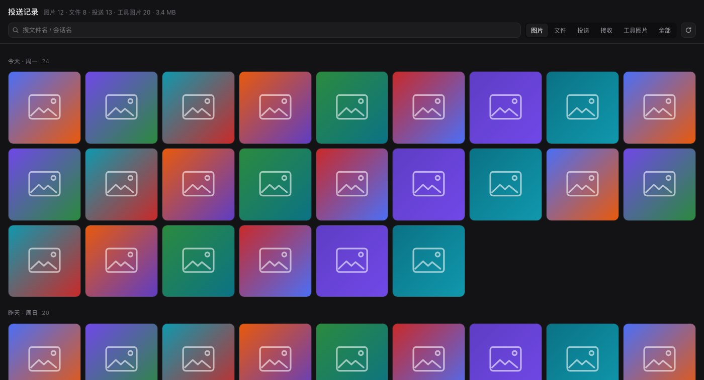
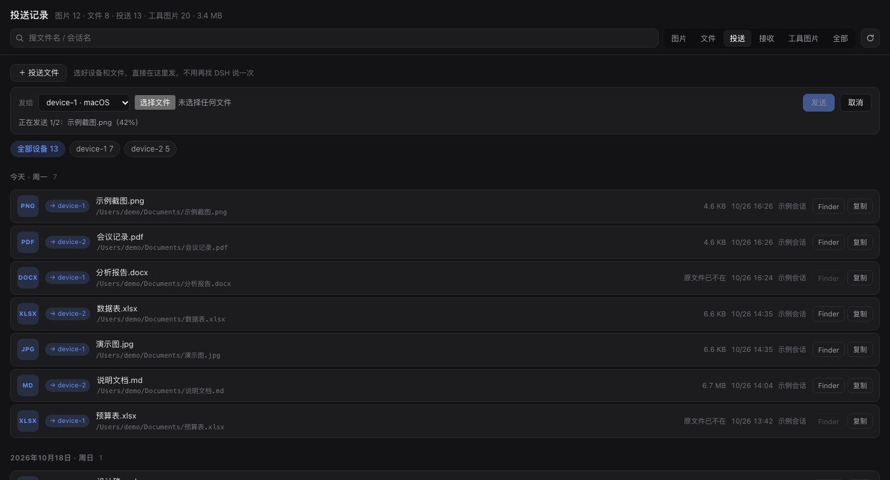
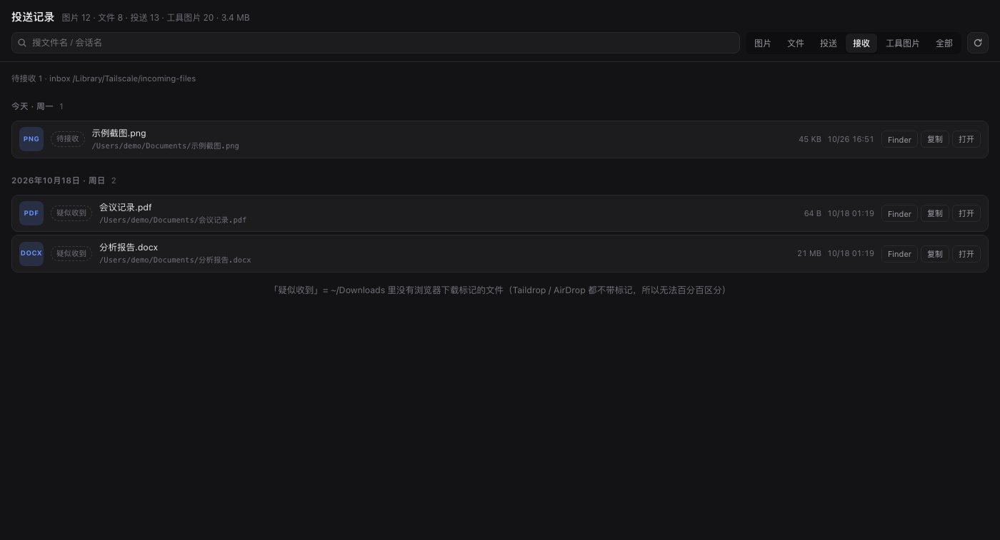

# dsh-attachment-panel（投送记录）

> DeepSeek Harness 的投送面板：发给 DSH 的图片与文件、`@` 引用过的本机路径、Taildrop 发出去和收到的文件，全按设备与时间列出来 —— 还能**直接在面板里选设备发文件**。

一个 DSH Web 插件。零第三方依赖，只注册一个同源路由 `/dsh-ap`，不新起服务、不占新端口。**macOS 优先**（macOS 版 Tailscale 恰好没有 Taildrop 的图形界面，这个面板顺手把它补上）；Linux / Windows 上会降级运行，见「平台支持」。



> 截图里是脱敏后的演示数据：文件名、路径、会话名、设备名都已替换成示例。

## 它补的四个洞

1. **macOS 没有 Taildrop 图形界面。** 官方只有右键 Share 菜单和 `tailscale file cp`，发完没有任何记录，丢了就找不回。
2. **DSH 里发过的图片和文件，只能滚回会话里翻。** 附件实体是内容寻址存盘（文件名就是 sha256），原名只活在会话日志里。
3. **`@` 引用过的文件，路径只存在于当时那条消息的文本里。** 过几天想再打开那个 docx，只能让 agent 去搜。
4. **别的设备投过来的东西落在 `~/Downloads`**，和浏览器下载混在一起，分不清哪来的。

## 安装

```bash
# 官方 CLI（会顺手把 bundle 挂进 profile）
dsh plugin --profile desktop add dsh-attachment-panel
```

或者手动挂：把包 link 进 profile 的 `dependencies`，再把 `dsh-attachment-panel` 加进 `dsh.profile.bundles`（本插件自带 `cordis.patch.yml`，bundle 通道会自动 insert 那一行）。

装完**重启 DSH**，侧栏「新会话」下面就会出现「投送记录」（和「插件」「自动化任务」并列），点它主区域整块换成面板。也能直接开 <http://127.0.0.1:19387/dsh-ap>，加 `?scope=file|send|recv` 直达某个标签。

> 客户端半边只改一次就生效的条件：改 `lib/client.js` 后刷新页面；宿主半边（`lib/index.js`）改动需要重启 DSH。`lib/panel.html` 是按 mtime 热读的，改完刷新即可。

## 五个标签

| 标签 | 内容 | 操作 |
|---|---|---|
| **图片** | 你发给 DSH 的图片附件（按天分组、时间倒序） | 大图查看、`←`/`→` 翻页、Finder 定位、复制路径 |
| **文件** | 你 `@` 引用过的本机路径（docx / zip / md / psd / 目录…） | Finder / 复制 / 用默认程序打开 |
| **投送** | Taildrop 发出去的文件，按目标设备分组 | 设备药丸筛选、**＋ 投送文件** 直接发 |
| **接收** | Taildrop 收到的文件 | 一键从 inbox 收下、Finder / 打开 |
| **工具图片** | DSH 自己产出或读到的图（截图、预览等） | 同「图片」 |

搜索对所有标签生效：文件名、会话名、目录、扩展名、类型词（「截图」「png」「投送」）都能搜。

### 投送：直接发



**＋ 投送文件** → 选设备（实时读 `tailscale debug localapi file-targets`，离线设备置灰）→ 选文件（可多选）→ 带百分比进度上传 → 宿主落临时目录 → `tailscale file cp --name <名字> <临时文件> <设备>:` → 清理临时文件。

成功的记录会追加到 `~/.dsh/attachments/v1/panel-sends.jsonl` 并进索引，所以面板自己发的也能追溯。单文件上限 2 GB（`SEND_MAX_BYTES`，是我加的软限制，不是 Tailscale 的限制）。

### 接收：待接收 + 疑似收到



- **待接收**：`/Library/Tailscale/incoming-files/`（准确）。有东西时「从 inbox 收下」可点，等价于 `tailscale file get ~/Downloads`。
- **疑似收到**：`~/Downloads` 近 14 天里**既没有 `com.apple.quarantine`（浏览器下载）也没有 `com.apple.provenance`（App 内传输）**的文件。实测本机 149 个下载文件里，72 + 21 个被这两个标记滤掉，只剩 3 个「疑似」，其中就有真正 Taildrop 收到的那个。

macOS 版 Tailscale 收到文件会**直接存 `~/Downloads`**，不留任何可查记录（通知中心数据库被系统 TCC 保护，偏好设置里也没有 Taildrop 收件记录），所以接收这一侧只能给「疑似」，做不到 100% 确定 —— 面板里也照实标注。

## 数据从哪来

| 东西 | 位置 |
|---|---|
| 附件实体（内容寻址） | `~/.dsh/attachments/v1/objects/<sha256 前两位>/<sha256>` |
| 原名 / 会话 / 时间 / 尺寸 | `~/.dsh/sessions/<工作区>/<会话>/session.v4.jsonl.zstd` 的 `user/message`、`tool/result` 事件 |
| 会话标题 | 同一份日志的 `session/title` 事件 |
| `@` 引用过的文件 | 用户消息文本里的 `@/绝对路径` 或 `@"带空格的路径"` |
| 投送记录 | `tool/call` 事件里的 `tailscale file cp [--name x] <files...> <device>:` |
| 面板自己发的投送 | `~/.dsh/attachments/v1/panel-sends.jsonl` |
| 索引缓存（可删） | `~/.dsh/attachments/v1/panel-index.json` |
| 缩略图缓存（可删） | `~/.dsh/attachments/v1/thumbs/<sha256>@<宽>.jpg` |

会话日志是**多帧 zstd**：每 append 一次写一帧，`zlib.zstdDecompressSync` 只认单帧，所以这里按 magic `28 B5 2F FD` 扫帧边界再逐帧解。全量 170 多个会话 / 100 MB 日志约 1.2 秒，之后靠版本号（size+mtime）判断要不要后台重建。

## 路由

挂在宿主 webServer 上的前缀路由 `/dsh-ap`（loopback，无 cookie 也能访问）：

```
GET  /dsh-ap                            面板页面（读 lib/panel.html）
GET  /dsh-ap/api/index?scope=user|file|send|recv|tool|all[&refresh=1]
GET  /dsh-ap/api/thumb/<sha256>?w=192|320|480|768
GET  /dsh-ap/api/raw/<sha256>           原文件
GET  /dsh-ap/api/targets                Taildrop 目标设备（在线状态/系统/内网 IP）
POST /dsh-ap/api/send?target=X&name=Y   请求体 = 文件字节，宿主代发
GET  /dsh-ap/api/received[?refresh=1]   接收列表（60 秒缓存）
POST /dsh-ap/api/receive-pull           {"dir":"/Users/…/Downloads"} → tailscale file get
POST /dsh-ap/api/reveal                 {"id":"sha256:…"} 附件 → 在文件管理器里显示
POST /dsh-ap/api/reveal-path            {"path":"/…"} 引用/收到的文件 → 定位
POST /dsh-ap/api/open-path              {"path":"/…"} 用默认程序打开
GET  /dsh-ap/api/health                 自检
```

## 平台支持

| 能力 | macOS | Linux | Windows |
|---|---|---|---|
| 附件索引 / 文件索引 / 投送历史 / 面板 UI | ✅ | ✅ | ✅ |
| 缩略图（`sips`） | ✅ | 回落成原图 | 回落成原图 |
| Finder / 打开 | `open` | `xdg-open` | `explorer /select,` |
| Taildrop 发送 / 接收 / inbox | ✅ | ✅（inbox 在 `/var/lib/tailscale/files`，通常是 root） | ✅（inbox 在 `%ProgramData%\Tailscale\files`） |
| 接收侧「疑似收到」过滤（`xattr`） | ✅ | 跳过（只列待接收） | 跳过 |

`tailscale` 可执行文件按平台候选探测（`/usr/local/bin`、`/opt/homebrew/bin`、`/Applications/Tailscale.app/Contents/MacOS/Tailscale`、`/usr/bin`…），也可以用环境变量 `DSH_TAILDROP_TAILSCALE` 直接指定。

## 已知限制

- **Taildrop 本身还在 alpha**，官方限制见 [Taildrop 文档](https://tailscale.com/docs/features/taildrop)：只能在自己的设备之间传、**tagged 节点不能收发**、续传窗口 1 小时且 **macOS/iOS 作为接收方不能续传**。
- **查不到对方有没有收到**：Tailscale 协议没有回执，任何面板都变不出来。
- 投送历史只覆盖 **DSH 执行过的** `tailscale file cp`；手动在终端发的不会进历史。
- 接收的「疑似收到」是启发式，不是确认；想更准，可以把 Tailscale 的落点/流程改成走 inbox。
- 单文件 2 GB 上限（面板自己设的软限制）。

## 安全

- 路由只挂在 **loopback** 的 DSH webServer 上，不新开端口、不监听外网。
- 文件操作走**白名单**：只有出现在索引或接收列表里的路径才允许 reveal / open，其他一律 404。
- 投送只接受 `file-targets` 返回过的设备名，避免被拿来投到任意主机。
- 上传的文件先落系统临时目录（`$TMPDIR/dsh-ap-send/`），发送后清理。
- 索引里不含文件内容；缩略图是本机生成的缓存。

## 开发

```bash
npm test           # test/smoke.mjs：起本地服务，验页面/健康检查/索引/设备/接收/白名单
```

- 改 `lib/panel.html`（CSS/JS 都在里面）→ 刷新页面即生效。
- 改 `lib/client.js`（侧栏入口 + `main` 面板壳）→ 刷新页面。
- 改 `lib/index.js`（宿主半边）→ 重启 DSH。
- 卸载：从 profile 的 `dependencies` 和 `dsh.profile.bundles` 里去掉，或直接 `dsh plugin remove`。

## License

MIT © 2026 thy
